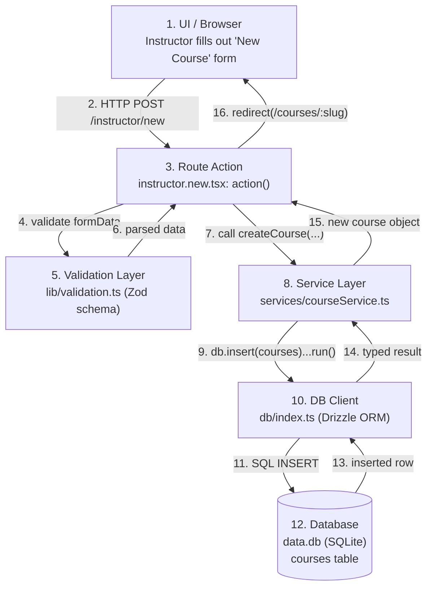

# Architecture

Cadence is a full-stack course platform (think a mini Udemy) built with React Router v7 (SSR), TypeScript, SQLite, and Drizzle ORM. It's the exercise repo for the [AI Coding Crash Course](https://www.aihero.dev/workshops/ai-coding-crash-course).

## Tech Stack

- **Framework:** React Router v7 with SSR
- **Language:** TypeScript 5.9
- **Database:** SQLite via Drizzle ORM
- **Styling:** Tailwind CSS 4 + shadcn/ui
- **Testing:** Vitest
- **Build:** Vite 7
- **Real-time:** Ably for live presence

## Layers

The app follows a straightforward layered request flow — each layer has one job and only talks to the layer directly below it:

1. **UI / Browser** — React components rendered in the browser (or on the server during SSR). The user interacts with a page (e.g. clicking "Create Course").
2. **Routes** (`app/routes/*.tsx`) — React Router route modules, registered in `app/routes.ts`. Each route exports a `loader` (reads data for GET requests) and/or an `action` (handles form submissions / mutations). This is the only layer allowed to know about HTTP concerns like `request`, `formData`, redirects, and status codes.
3. **Validation** (`app/lib/validation.ts`) — Route actions parse and validate incoming form data (using Zod schemas) before anything touches business logic.
4. **Services** (`app/services/*.ts`) — Plain functions that hold business logic and data-access queries (e.g. `courseService.ts`, `enrollmentService.ts`). Routes call services; services never import route/UI code.
5. **DB Client** (`app/db/index.ts`) — A lazily-initialized Drizzle ORM instance wrapping a `better-sqlite3` connection. Services use this to build and run queries.
6. **Database** (`data.db`, schema in `app/db/schema.ts`) — SQLite file on disk. Tables include `users`, `courses`, `modules`, `lessons`, `enrollments`, `purchases`, `quizzes`, `teams`, `coupons`, etc.

Cross-cutting concerns like the current user's session (`app/lib/session.ts`) are read inside route loaders/actions, before calling into services.

## Request Flow Diagram

Example: an instructor creates a new course from `/instructor/new`.

### Reading the numbers

| # | Step |
|---|------|
| 1 | User submits the "New Course" form in the browser |
| 2 | Browser sends an HTTP POST to the matching route |
| 3 | React Router invokes that route's `action()` |
| 4 | Action passes raw `formData` to the validation layer |
| 5 | Zod schema validates and coerces the input |
| 6 | Validated, typed data is returned to the action |
| 7 | Action calls a service function (`createCourse`) |
| 8 | Service layer builds the query using Drizzle |
| 9 | Service runs the insert against the DB client |
| 10 | DB client (Drizzle + better-sqlite3) prepares the SQL |
| 11 | SQL statement is executed against the database |
| 12 | SQLite persists the new row in the `courses` table |
| 13 | Database returns the inserted row |
| 14 | DB client returns a typed result to the service |
| 15 | Service returns the new course object to the route |
| 16 | Route redirects the browser to the new course's page |

This same pattern (UI → Route → Validation → Service → DB Client → Database) applies to every mutation and read in the app — only the specific route/service/table involved changes.
